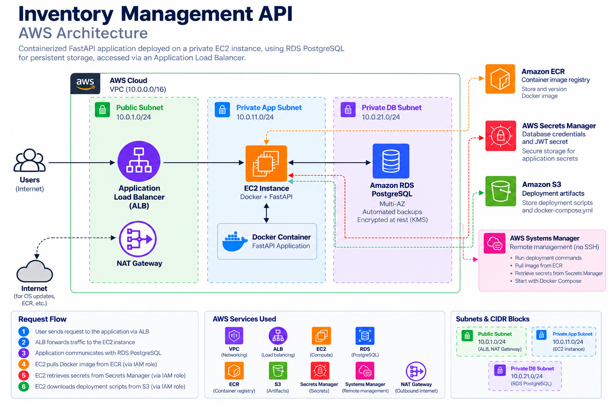

# Inventory Management API — AWS Infrastructure & Deployment

> **Focus:** Terraform, AWS networking, private EC2, Docker, and remote deployment

# Inventory Management API — AWS Infrastructure & Deployment



## Overview

Provisioned a modular AWS environment with Terraform and deployed a Dockerized FastAPI inventory service to an EC2 instance in a **private subnet**. The API is reachable through a public Application Load Balancer (ALB); its PostgreSQL database runs on Amazon RDS in private database subnets.

Deployments are initiated from a local machine using **AWS Systems Manager Run Command**, with versioned deployment scripts stored in S3 and container images stored in ECR. No inbound SSH access is required for the deployment workflow.

## Architecture

```text
Browser / HTTP client
        |
        v
Internet-facing ALB (public subnets, HTTP :80)
        |
        v
Private EC2 (host :8000)
        |
        v
Docker Compose / FastAPI (container :8055)
        |
        v
Amazon RDS PostgreSQL (private DB subnets)

Supporting services: ECR, S3, Secrets Manager, IAM, SSM, NAT Gateway
```

See [architecture.md](./architecture.md) for the network and deployment flows.

## Technology Stack

| Area | Technologies |
| --- | --- |
| Infrastructure | Terraform, AWS VPC, subnets, route tables, NAT Gateway, security groups |
| Compute and routing | EC2, Application Load Balancer, target group |
| Containers | Docker, Docker Compose, Amazon ECR |
| Database | Amazon RDS for PostgreSQL |
| Deployment | Bash, AWS CLI, S3, AWS Systems Manager |
| Secrets and access | AWS Secrets Manager, IAM instance profile |
| Application | Python, FastAPI |

## What Was Implemented

- Reusable Terraform modules for networking, security groups, compute, database, IAM, secrets, ECR, S3 deployment storage, and ALB.
- Public subnets for the internet-facing ALB; private application and database subnets for EC2 and RDS.
- Restricted security group access: ALB → EC2 on TCP 8000; EC2 → RDS on TCP 5432.
- Docker image built locally, tagged `v1`, and pushed to ECR.
- Versioned `deploy.sh` and `compose.yaml` uploaded to an S3 release prefix.
- Remote deployment through SSM: fetch artifacts, retrieve secrets, pull image, initialize schema, and start the API.
- ALB HTTP listener, instance target group, and application routing.

## Verification

| Check | Observed result |
| --- | --- |
| Terraform ALB addition | `4 to add, 0 to change, 0 to destroy` |
| SSM deployment | `Success` |
| RDS initialization | `Database schema initialized` |
| Docker/Uvicorn | Container running; application startup complete |
| EC2-local `/docs` | HTTP `200 OK` |
| Public `/docs` | Swagger UI loaded through ALB |
| Public `/ready` | `{"status":"ready"}` |
| Test registration | HTTP `201 Created` |
| Test login | HTTP `200 OK` with bearer token |
| Viewer attempting admin action | HTTP `403 Forbidden` |

These are deployment and smoke-test results, **not** a claim of comprehensive application QA or production readiness.

## Challenges and Lessons

- **Bootstrap networking:** EC2 could reach SSM, but package installation failed because outbound TCP 80 was missing from the application security group. Added the rule through Terraform and reran the bootstrap script using SSM.
- **Architecture completeness:** The initial Terraform setup defined ALB security groups but no ALB resources. Added an ALB module after verifying the application locally, without replacing existing infrastructure.
- **Operational verification:** Confirmed container startup, HTTP response, and public routing separately instead of assuming a successful Terraform apply proved application health.

Detailed commands, debugging, and decisions are in [notes.md](./notes.md).

## Scope and Future Improvements

This project covers **infrastructure provisioning and scripted deployment**. The following were **not implemented** as part of this project:

- Automated CI/CD pipeline (reserved for a later project)
- HTTPS/TLS termination and a custom domain
- Multi-instance application high availability and automated rollbacks
- Comprehensive metrics, centralized logging, and alerting

The ALB currently serves **HTTP only**. Use disposable test data; do not send real credentials or sensitive data over this endpoint.

## Cost and Cleanup

EC2, RDS, NAT Gateway, ALB, and related resources can incur charges while provisioned. When the lab is no longer needed, review the Terraform plan and destroy the environment intentionally. Confirm database-data retention requirements first; versioned S3 objects and other retained resources may require separate cleanup.

## Documentation

- [Architecture](./architecture.md)
- [Implementation notes and troubleshooting](./notes.md)

**Outcome:** A publicly reachable, containerized FastAPI service deployed to private AWS compute using modular Terraform and SSM-driven deployment scripts. CI/CD automation is deliberately deferred to the next project.
