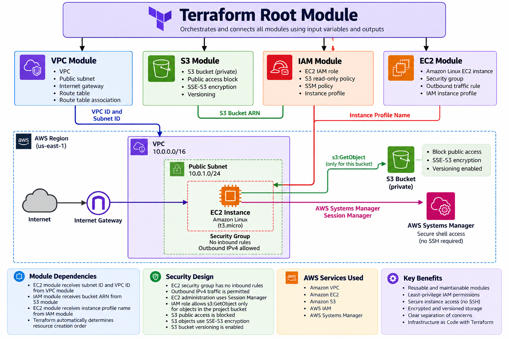

# Project 03 — Reusable AWS Infrastructure with Terraform Modules



## Project Overview

This project demonstrates how to provision and manage AWS infrastructure using reusable Terraform modules.

Rather than defining every AWS resource in a single configuration file, the infrastructure is organized into four independent modules:

- **VPC:** Creates a custom VPC, public subnet, internet gateway, and public routing configuration.
- **EC2:** Deploys an Amazon Linux EC2 instance with a security group and configurable IAM instance profile.
- **S3:** Creates a private S3 bucket with server-side encryption, versioning, and public access blocking.
- **IAM:** Creates an EC2 IAM role with least-privilege S3 object-read permissions and AWS Systems Manager access.

The root Terraform configuration connects these modules through input variables and output values.

## Project Objectives

- Build reusable and maintainable Terraform modules.
- Understand dependencies between Terraform resources and modules.
- Provision AWS networking, compute, storage, and IAM resources.
- Apply least-privilege IAM permissions.
- Access EC2 securely using AWS Systems Manager Session Manager.
- Validate infrastructure functionality through practical testing.
- Manage infrastructure changes using Terraform state and execution plans.
- Track infrastructure code using Git and GitHub.


## Project Structure

```text
project-03-terraform-modules/
├── architecture.png
├── README.md
├── NOTES.md
├── .gitignore
├── .terraform.lock.hcl
├── main.tf
├── providers.tf
├── outputs.tf
└── modules/
    ├── vpc/
    │   ├── main.tf
    │   ├── variables.tf
    │   └── outputs.tf
    ├── ec2/
    │   ├── main.tf
    │   ├── variables.tf
    │   └── outputs.tf
    ├── s3/
    │   ├── main.tf
    │   ├── variables.tf
    │   └── outputs.tf
    └── iam/
        ├── main.tf
        ├── variables.tf
        └── outputs.tf
```

### Configuration Files

- **main.tf:** Calls the four modules and connects their inputs and outputs.
- **providers.tf:** Defines Terraform and AWS provider requirements.
- **outputs.tf:** Exposes important infrastructure details after deployment.
- **variables.tf:** Defines configurable inputs for each reusable module.
- **.terraform.lock.hcl:** Records provider dependency selections for reproducible initialization.
- **.gitignore:** Prevents Terraform state, local provider files, and sensitive variable files from being committed.


## Prerequisites

Before deploying this project, ensure you have:

- Terraform installed.
- An AWS account.
- AWS CLI installed and configured with appropriate credentials.
- IAM permissions to create and manage VPC, EC2, S3, IAM, and related resources.

The infrastructure is configured to deploy in **AWS Region `us-west-1` (N. California)**.

## Deployment Instructions

### 1. Clone the Repository

```bash
git clone https://github.com/devEbuka/devops-project-labs.git
cd devops-project-labs/project-03-terraform-modules
```

### 2. Initialize Terraform

```bash
terraform init
```

Downloads the required providers and initializes the working directory and local modules.

### 3. Validate the Configuration

```bash
terraform validate
```

Checks the Terraform configuration for syntax errors and internal consistency.

### 4. Review the Execution Plan

```bash
terraform plan
```

Shows the infrastructure changes Terraform intends to make before deployment.

### 5. Deploy the Infrastructure

```bash
terraform apply
```

Review the proposed changes and enter `yes` to approve the deployment.

### 6. Inspect the Outputs

```bash
terraform output
```

Displays the VPC, subnet, EC2, and S3 information exposed by the root module.
```


## Infrastructure Verification

After deployment, the infrastructure was tested to verify resource provisioning, EC2 access, and IAM permissions.

### 1. Terraform State Verification

```bash
terraform state list
```

Confirmed that Terraform tracked the deployed infrastructure resources across all four modules.

### 2. EC2 Access Through Session Manager

Connected to the Amazon Linux EC2 instance using AWS Systems Manager Session Manager.

- No SSH key was required.
- Port 22 was not opened.
- The EC2 security group had no inbound rules.
- The instance used an IAM instance profile with the `AmazonSSMManagedInstanceCore` managed policy.

### 3. Verify the EC2 IAM Role

Executed the following command from the EC2 instance:

```bash
aws sts get-caller-identity
```

Confirmed that the instance was using the assumed role:

```text
assumed-role/dev-ec2-s3-role/<instance-id>
```

### 4. Test S3 Least-Privilege Permissions

A test object named `test.txt` was uploaded to the project S3 bucket.

**Test A — List bucket contents**

```bash
aws s3 ls s3://dev-ebuka-terraform-lab-20261013/
```

**Result:** `AccessDenied`

This was expected because the IAM policy did not grant `s3:ListBucket`.

**Test B — Download a known object**

```bash
aws s3api get-object \
  --bucket dev-ebuka-terraform-lab-20261013 \
  --key test.txt \
  /tmp/downloaded-test.txt
```

**Result:** Successful.

The IAM role granted `s3:GetObject` for objects in the project bucket.

Verified the downloaded file:

```bash
cat /tmp/downloaded-test.txt
```

Output:

```text
Hello from our Terraform S3 lab!
```

### Verification Summary

| Test | Expected Result | Actual Result |
|------|-----------------|---------------|
| Terraform validation | Valid configuration | Passed |
| Terraform deployment | Infrastructure provisioned | Passed |
| Session Manager access | EC2 accessible without SSH | Passed |
| EC2 IAM role | Correct assumed role | Passed |
| S3 ListBucket | Access denied | Passed |
| S3 GetObject | Object downloaded | Passed |

These tests confirmed that the infrastructure was functional and that the EC2 instance operated with restricted S3 permissions.


## Infrastructure Cleanup

To avoid unnecessary AWS charges, destroy the infrastructure when the lab is no longer needed.

### 1. Empty the S3 Bucket

The S3 bucket has versioning enabled and contains a test object.

Before destroying the infrastructure:

1. Open the AWS S3 Console.
2. Select the project bucket.
3. Choose **Empty**.
4. Follow the confirmation instructions to permanently remove all objects, including object versions and delete markers.

**Warning:** Emptying the bucket permanently deletes its contents.

### 2. Review the Destruction Plan

From the project directory, run:

```bash
terraform plan -destroy
```

Review the resources Terraform intends to delete.

### 3. Destroy the Infrastructure

```bash
terraform destroy
```

Review the proposed changes and enter `yes` to confirm.

### 4. Verify Cleanup

```bash
terraform state list
```

After successful destruction, no managed infrastructure resources should remain in Terraform state.

Also verify in the AWS Console that the EC2 instance and other project resources have been removed.

## Cost Considerations

- EC2 instances and public IPv4 addresses may incur charges while provisioned.
- S3 storage and requests may incur charges.
- Terraform itself does not automatically stop or delete infrastructure when execution finishes.
- Destroy lab resources when they are no longer required.

